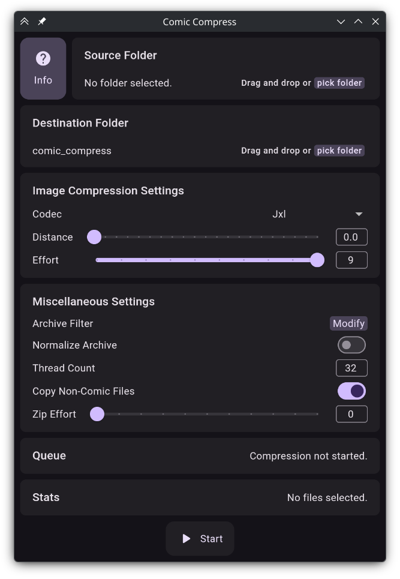

# Comic Compress

Program for compressing comic files in batch. Supports multi threading, different image formats and archive filtering / normalization.

## Dependencies

Comic Compress depends on cjxl (libjxl), cwebp (libwebp) and exiftool. Please make sure these are installed on your computer.

## Usage

Pick input and output folders, configure the compression settings and start.



## Build

``` 
git clone https://github.com/lojcs/comic_compress.git --recurse-submodules
.flutter/bin/flutter pub get
.flutter/bin/flutter build linux
```
## Ai disclosure
This project was hand-coded except for the github actions workflow.